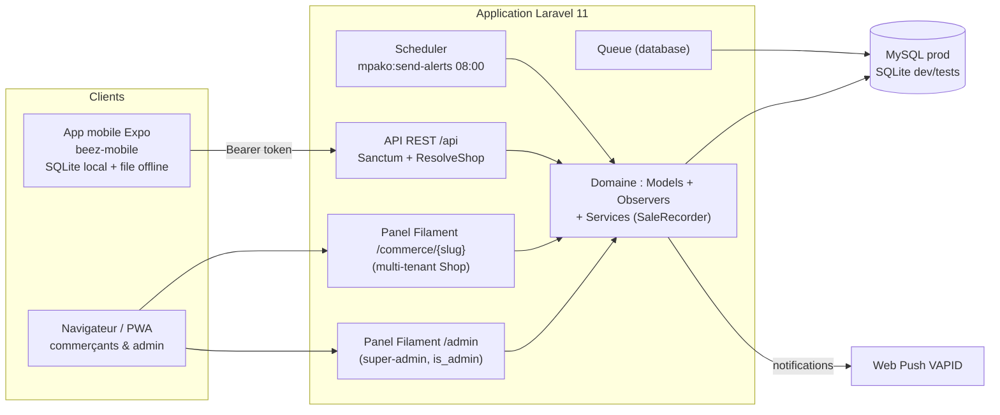
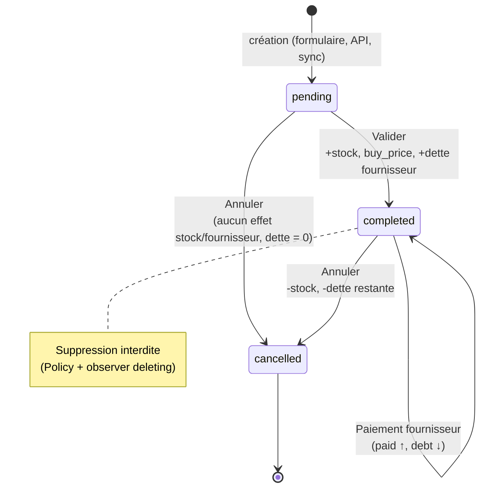
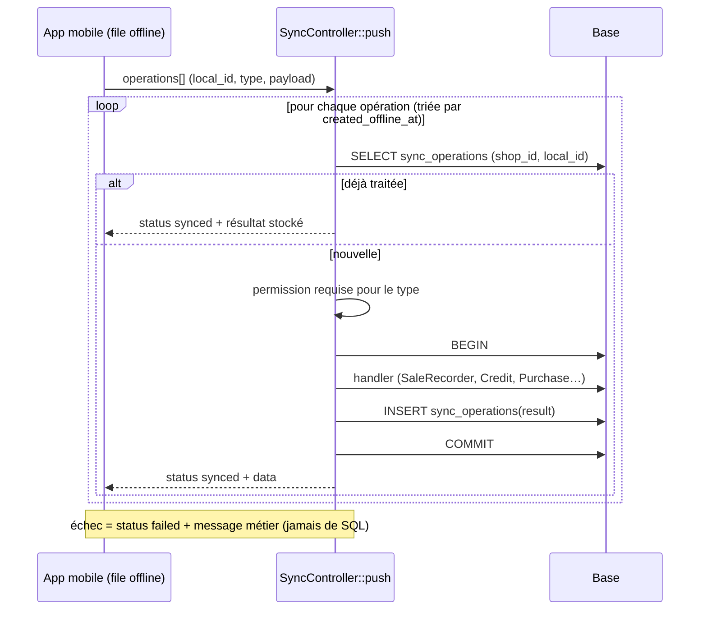
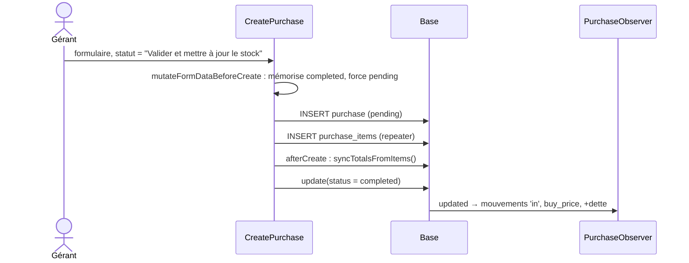

# BeeZ (Mpako) — Document d'architecture technique

> Version : Sprint 1 (stabilisation) — novembre 2026
> Public : développeurs backend / mobile, mainteneurs
> Code de référence : branche `modulepro`

---

## 1. Stack technique

| Couche | Technologie | Version |
|---|---|---|
| Langage | PHP | ^8.2 (dev : 8.3 via Laravel Herd) |
| Framework | Laravel | ^11.31 (11.52 installé) |
| Back-office | Filament | ^3.3 (2 panels) |
| RBAC | spatie/laravel-permission + bezhansalleh/filament-shield | Shield ^3.9 |
| API mobile | Laravel Sanctum | ^4.0 (tokens personnels) |
| PDF | barryvdh/laravel-dompdf | ^3.1 |
| Export Excel | maatwebsite/excel | ^3.1 |
| 2FA | pragmarx/google2fa-laravel + bacon/bacon-qr-code | ^3.0 / ^3.1 |
| Push web | laravel-notification-channels/webpush | ^10.5 |
| PWA | silviolleite/laravelpwa | ^2.0 |
| Front | Tailwind CSS 3.4, Vite 6, animejs | — |
| Base de données | MySQL (prod + dev local actuel), SQLite (`.env.example`, tests) | — |
| Tests | PHPUnit 11 (SQLite `:memory:`) | — |
| App mobile | Expo / React Native (`beez-mobile`, offline-first avec expo-sqlite) | — |

Paramètres régionaux : `APP_TIMEZONE=Indian/Comoro`, `APP_LOCALE=fr`, devise **KMF**, Carbon en locale `fr`.

---

## 2. Vue d'ensemble



Principe directeur : **toute règle de cohérence vit dans le domaine** (observers, hooks de modèle, `SaleRecorder`). Les panels et l'API ne sont que des points d'entrée et ne doivent jamais recalculer un stock ou une balance à la main.

---

## 3. Multi-tenancy

| Élément | Implémentation |
|---|---|
| Tenant | `App\Models\Shop` (`slug` unique) |
| Appartenance | Pivot `shop_user` (un utilisateur peut appartenir à plusieurs commerces) — `User::shops()`, `Shop::members()` |
| URL panel | `/commerce/{shop_slug}/...` — `->tenant(Shop::class, ownershipRelationship: 'shop', slugAttribute: 'slug')` |
| Accès panel | `User::canAccessTenant()` : membre du shop |
| URL API | `/api/shop/{shop_slug}/...` résolu par le middleware `ResolveShop` |
| Isolation des données | Colonne `shop_id` sur toutes les tables métier |

### Règles de scoping (obligatoires)

1. **Requêtes** : toujours partir de la relation du shop (`$shop->products()`, `$shop->credits()->findOrFail($id)`), jamais d'un `Model::find($id)` brut.
2. **Validation API** : toute clé étrangère reçue du client est validée avec `InteractsWithShop::inShop($table, $shop)` → règle `exists:{table},id` restreinte au `shop_id` courant.
3. **Filament** : les `Select` / `SelectFilter::relationship()` doivent recevoir un `modifyQueryUsing` filtrant sur `Filament::getTenant()` (Filament v3 ne le fait pas pour les filtres).
4. **Garde-fou domaine** : `StockMovementObserver::creating` refuse un mouvement dont le produit appartient à un autre shop ; `PurchaseObserver` ignore une ligne d'achat dont le produit n'appartient pas au shop de l'achat.

### Middleware `ResolveShop` (API)

1. Shop trouvé par slug **et actif** — sinon `404`.
2. Si l'utilisateur n'est pas super-admin :
   - `is_approved` re-vérifié **à chaque requête** — sinon `403` (un token de 30 j ne survit pas à une désactivation) ;
   - appartenance au shop — sinon `403`.
3. Le shop est injecté dans `$request->attributes['shop']`.

---

## 4. Contrôle d'accès (RBAC)

### 4.1 Modèle

- **Spatie Permission**, garde `web`, **`teams => false`** : les rôles sont **globaux** à l'utilisateur.
- **Filament-Shield** génère les permissions à partir des Resources/Pages/Widgets :

| Type | Format | Exemples |
|---|---|---|
| Resource | `{action}_{modèle}` | `view_any_purchase`, `create_purchase`, `update_credit`, `delete_any_sale` |
| Modèle composé | `::` | `create_stock::movement`, `view_any_expense::category`, `view_wallet::transaction` |
| Page | `page_{Classe}` | `page_Caisse`, `page_ProfitReport`, `page_SalesReport` |
| Widget | `widget_{Classe}` | `widget_StatsOverviewWidget` |

- Les **Policies** (`app/Policies`) appellent `$user->can('<permission>')`. Exception : `PurchasePolicy::delete` exige en plus `status !== 'completed'` ; `WalletPolicy::approve/reject` exigent `is_admin`.
- L'API utilise les **mêmes noms de permission** via `InteractsWithShop::authorizeAny()` (les `is_admin` passent toujours).

### 4.2 Rôles (`ShopRolesSeeder`)

| Rôle | Permissions |
|---|---|
| `owner` | Toutes les permissions **sauf** celles réservées au super-admin (shop, user, role, subscription, subscription::plan, wallet, wallet::transaction, widgets admin) — avec exceptions : `view_shop`, `update_shop` (profil du commerce), lecture du portefeuille et de ses transactions |
| `manager` | Permissions de `owner` moins `*_employee` et `*_role` |
| `cashier` | `view_any/view_product`, `view_any/view/create_sale`, `view_any/view/create_credit`, `view_any/view/create_customer`, **`page_Caisse`** |
| `super_admin` (Shield) | Toutes les permissions (panel admin) |

### 4.3 Accès aux panels

`User::canAccessPanel()` :
- `/admin` → `is_admin === true` (login dédié + 2FA possible) ;
- `/commerce` → `is_approved === true` (inscription publique, validation par l'admin).

### 4.4 Limite connue (dette)

Les rôles étant globaux, un utilisateur **owner** d'un commerce A et **caissier** d'un commerce B possède les droits owner dans B. Correctif prévu au backlog : activer `teams` avec `team_id = shop_id` + middleware `setPermissionsTeamId()`, ou porter le rôle sur le pivot `shop_user`. Pour la même raison, `RegisterShop` **n'attribue pas** automatiquement le rôle `owner` au créateur d'un commerce (cela l'élèverait dans tous ses commerces) : l'attribution reste manuelle côté admin.

---

## 5. Modèle de données

```mermaid
erDiagram
    USERS ||--o{ SHOP_USER : "membre"
    SHOPS ||--o{ SHOP_USER : "a"
    SHOPS ||--o{ PRODUCTS : ""
    SHOPS ||--o{ CATEGORIES : ""
    SHOPS ||--o{ UNITS : ""
    SHOPS ||--o{ CUSTOMERS : ""
    SHOPS ||--o{ SUPPLIERS : ""
    SHOPS ||--o{ SALES : ""
    SHOPS ||--o{ PURCHASES : ""
    SHOPS ||--o{ CREDITS : ""
    SHOPS ||--o{ EXPENSES : ""
    SHOPS ||--o{ STOCK_MOVEMENTS : ""
    SHOPS ||--o| WALLETS : "1 max"
    SHOPS ||--o{ SYNC_OPERATIONS : ""
    PRODUCTS ||--o{ STOCK_MOVEMENTS : ""
    SALES ||--|{ SALE_ITEMS : ""
    SALES ||--o| CREDITS : "vente à crédit"
    PURCHASES ||--|{ PURCHASE_ITEMS : ""
    PURCHASES ||--o{ SUPPLIER_PAYMENTS : ""
    SUPPLIERS ||--o{ PURCHASES : ""
    CUSTOMERS ||--o{ CREDITS : ""
    CREDITS ||--o{ CREDIT_PAYMENTS : ""
    EXPENSE_CATEGORIES ||--o{ EXPENSES : ""
    WALLETS ||--o{ WALLET_TRANSACTIONS : ""
    WALLETS ||--o{ SUBSCRIPTIONS : ""
    SUBSCRIPTION_PLANS ||--o{ SUBSCRIPTIONS : ""

    SHOPS {
        bigint id PK
        string name
        string slug UK
        enum island
        string currency
        bool is_active
        timestamp subscription_expires_at
    }
    USERS {
        bigint id PK
        string phone
        string email
        bool is_admin
        bool is_approved
    }
    PRODUCTS {
        bigint id PK
        bigint shop_id FK
        decimal buy_price
        decimal sell_price
        decimal stock_qty
        decimal stock_alert
        bool is_active
    }
    STOCK_MOVEMENTS {
        bigint id PK
        bigint shop_id FK
        bigint product_id FK
        enum type "in|out|adjustment"
        decimal quantity
        decimal stock_before
        decimal stock_after
    }
    SALES {
        bigint id PK
        string reference "VNT-YYYYMMDD-XXXX"
        string status "completed|cancelled"
        string payment_type "cash|credit"
        decimal total_amount
        decimal discount_amount
        bigint customer_id FK
    }
    SALE_ITEMS {
        bigint sale_id FK
        bigint product_id FK
        decimal quantity
        decimal unit_price
        enum discount_type "percent|fixed"
        decimal discount_amount
        decimal subtotal
    }
    PURCHASES {
        bigint id PK
        string reference "ACH-YYYYMMDD-XXXX"
        string status "pending|completed|cancelled"
        string payment_status "unpaid|partial|paid"
        decimal total_amount
        decimal paid_amount
        decimal debt_amount
        date purchased_at
    }
    PURCHASE_ITEMS {
        bigint purchase_id FK
        bigint product_id FK
        decimal quantity
        decimal conversion_qty
        decimal unit_cost
        decimal subtotal
    }
    CREDITS {
        bigint id PK
        string reference "CRD-YYYYMMDD-XXXX"
        string status "pending|partial|paid"
        decimal total_amount
        decimal paid_amount
        decimal remaining_amount
        date due_date
    }
    CUSTOMERS {
        bigint id PK
        decimal balance "dette client"
    }
    SUPPLIERS {
        bigint id PK
        decimal balance "dette envers fournisseur"
    }
    WALLETS {
        bigint id PK
        bigint shop_id UK
        decimal balance
        string status "draft|pending|approved|rejected"
    }
    WALLET_TRANSACTIONS {
        string reference UK
        string type "recharge|subscription|refund"
        decimal amount
        decimal balance_before
        decimal balance_after
    }
    SYNC_OPERATIONS {
        bigint shop_id FK
        string local_id
        string type
        json result
    }
```



Conventions :
- Montants : `decimal(10,2)` (portefeuille : `decimal(12,2)`).
- `customers.balance` et `suppliers.balance` sont des **dettes** (positif = doit de l'argent), maintenues **exclusivement** par les observers.
- `sync_operations` : contrainte unique `(shop_id, local_id)`.
- `wallets.shop_id` : unique (migration `2026_11_09_000002`).

---

## 6. Observers et hooks de modèle

Enregistrés dans `AppServiceProvider::boot()`. **Ne jamais les contourner** (pas d'`update()` en query builder sur ces champs, pas de suppression SQL directe).

| Composant | Événement | Effet |
|---|---|---|
| `StockMovementObserver` | `creating` | Complète `shop_id`/`user_id` ; **verrouille la ligne produit** (`lockForUpdate`) ; **refuse un produit d'un autre shop** ; calcule `stock_before`/`stock_after` (`in` +, `out` −, `adjustment` = valeur absolue) ; stock plancher à 0 avec log d'avertissement |
| `StockMovementObserver` | `created` | Écrit `product.stock_qty = stock_after` ; si le seuil d'alerte est **franchi** (avant > seuil ≥ après), notifie les membres **après commit** (`DB::afterCommit`), erreurs de push journalisées sans annuler la vente |
| `PurchaseObserver` | `created` | Si créé directement `completed` (cas résiduel seeders) → traitement de validation |
| `PurchaseObserver` | `updated` (→ `completed`) | Pour chaque ligne du shop : mouvement `in` (quantité × `conversion_qty`), mise à jour `buy_price` (coût / unité de détail) ; `supplier.balance += debt_amount` |
| `PurchaseObserver` | `updated` (→ `cancelled`) | Si l'achat était `completed` : mouvements `out` compensatoires + `supplier.balance -= debt_amount` ; dans tous les cas `debt_amount = 0` |
| `PurchaseObserver` | `deleting` | Retourne `false` (suppression annulée) si l'achat est `completed` |
| `Purchase` (modèle) | `saving` | `payment_status` toujours dérivé de `total/paid/debt` |
| `CreditObserver` | `created` | `customer.balance += remaining_amount` |
| `CreditObserver` | `updating` | Si `total_amount` change : recalcule `remaining_amount` et `status` |
| `CreditObserver` | `updated` | Répercute l'écart de `remaining_amount` sur `customer.balance` |
| `CreditObserver` | `deleted` | `customer.balance -= remaining_amount` |
| `CreditPaymentObserver` | `creating` | Verrouille le crédit ; refuse si déjà soldé ; **plafonne `amount` au reste dû** ; complète `user_id` |
| `CreditPaymentObserver` | `created` / `deleted` | Met à jour `paid/remaining/status` du crédit (`updateQuietly`) et `customer.balance` du montant exact |
| `SupplierPaymentObserver` | `creating` | Verrouille l'achat ; refuse si non `completed`, sans fournisseur ou déjà payé ; **plafonne au `debt_amount`** ; force `supplier_id`, complète `user_id` |
| `SupplierPaymentObserver` | `created` / `deleted` | Met à jour `paid/debt` de l'achat et `supplier.balance` ; suppression ignorée si l'achat n'est plus `completed` (pas de « résurrection » de dette) |

### Cycle de vie d'un achat



---

## 7. Flux critiques

### 7.1 Vente en caisse (panel Commerce, `Caisse`)

```mermaid
sequenceDiagram
    actor C as Caissier
    participant LW as Livewire Caisse
    participant DB as Base
    participant SMO as StockMovementObserver
    C->>LW: addToCart / remises (panier côté navigateur)
    C->>LW: completeSale()
    LW->>DB: rebuildCartFromDatabase()<br/>(prix réels, remise % ≤ 100)
    LW->>DB: BEGIN ; lockForUpdate produits ; contrôle stock
    LW->>DB: Sale::create + SaleItem::create (subtotal recalculé)
    LW->>SMO: StockMovement 'out' par ligne
    SMO->>DB: lock produit, stock_after, product.stock_qty
    LW->>DB: COMMIT
    SMO-->>C: (après commit) push stock faible si seuil franchi
```

### 7.2 Vente via l'API (`SaleRecorder`)

```mermaid
sequenceDiagram
    participant App as App mobile
    participant API as SaleController
    participant SR as SaleRecorder
    participant DB as Base
    App->>API: POST /api/shop/{slug}/sales
    API->>API: authorizeAny(create_sale) ; validate (inShop products/customers)
    API->>SR: record(shop, user, data, strictStock=true)
    SR->>DB: BEGIN ; produits du shop lockForUpdate
    SR->>SR: stock agrégé par produit, client obligatoire si crédit
    SR->>DB: Sale + SaleItems + StockMovements 'out'
    SR->>DB: total = Σ subtotals − remise globale (serveur)
    alt payment_type = credit
        SR->>DB: Credit::create → CreditObserver (+balance client)
    end
    SR->>DB: COMMIT
    API-->>App: 201 SaleResource
```

### 7.3 Sync offline — push idempotent



### 7.4 Création d'un achat validé dans Filament

Filament enregistre les lignes du repeater (`items`) **après** l'achat. Le `PurchaseObserver` ne peut donc pas traiter le stock au `created`.



`EditPurchase` applique le même principe (`mutateFormDataBeforeSave` / `afterSave`). Côté sync, `createPurchase` crée en `pending`, insère les lignes puis valide.

### 7.5 Mode hors ligne de la plateforme web

Le panel Filament repose sur Livewire : chaque interaction est un aller-retour serveur, donc il ne peut pas fonctionner sans réseau. Le mode hors ligne est une **application autonome** servie par Laravel et mise en cache par le service worker. Elle réutilise **exactement le protocole de sync de l'app mobile** (`pull` / `push` idempotent).

| Composant | Fichier | Rôle |
|---|---|---|
| Page | `routes/web.php` → `Commerce\OfflineController@show`, vue `resources/views/offline/app.blade.php` | `/commerce/{slug}/hors-ligne` (session web, membre approuvé du commerce) |
| Token du poste | `OfflineController@token` | Token Sanctum `web-offline:{shop}:{device}` (30 jours), stocké en IndexedDB |
| Interface | `resources/js/offline/app.js` (Alpine.js) | Caisse, produits, stock, clients et crédits, achats, fournisseurs, dépenses, sync |
| Effets locaux | `resources/js/offline/operations.js` | État affiché = **snapshot serveur + rejeu de la file** d'opérations en attente |
| Synchronisation | `resources/js/offline/sync.js` | Push de la file, puis `pull?light=1` qui devient le nouveau snapshot |
| Stockage | `resources/js/offline/db.js` | IndexedDB `beez-offline`, clés préfixées `{slug}:{userId}` |
| Cache | `public/serviceworker.js` (`beez-v2`) | Page et assets `/build/assets/*` en cache ; sans réseau, toute page `/commerce/{slug}/…` affiche l'application hors ligne |
| Pont avec le panel | `filament/components/offline-bridge.blade.php` + entrée de menu « Mode hors ligne » | **Préparation en arrière-plan** : l'application hors ligne est chargée dans une iframe invisible (toutes les 15 min). Elle met en cache la page et les assets, obtient le token et télécharge les données, puis prévient le panel (`postMessage` `beez-offline-ready`). « Prêt » signifie : page en cache **et** données synchronisées. Détection de coupure : événement `offline` + sonde `HEAD /up` toutes les 20 s, 2 échecs = hors ligne. **Bascule automatique** après 5 s, annulable (« Rester ici »), seulement si l'application est en cache ; sinon un message invite à se reconnecter une fois |

```mermaid
sequenceDiagram
    participant U as Utilisateur
    participant SW as Service worker
    participant APP as App hors ligne (Alpine)
    participant IDB as IndexedDB
    participant API as API /shop/{slug}
    U->>SW: navigation /commerce/{slug}/… (réseau coupé)
    SW-->>U: app hors ligne (cache)
    U->>APP: vente, nouveau produit, paiement…
    APP->>IDB: file += {type, local_id, payload}
    APP-->>U: effet visible (rejeu local)
    Note over APP: événement « online » ou minuterie 30 s
    APP->>API: POST /push (file)
    API-->>APP: résultats par local_id
    APP->>IDB: retire les « synced », marque les refus
    APP->>API: GET /pull?light=1
    API-->>APP: snapshot
    APP->>IDB: snapshot ; état = snapshot + file restante
```

**Règles de conception**
- **Le serveur reste la source de vérité.** Le rejeu local n'est qu'un affichage. Après chaque synchronisation, l'état est reconstruit à partir du snapshot serveur.
- **Références croisées.** Un élément créé hors ligne n'a pas d'`id`. Les opérations suivantes le désignent par `<x>_local_id`, que le serveur résout via `sync_operations` (voir [04-API.md § 6.2](04-API.md)).
- **Erreurs.** Une opération refusée définitivement (permission, validation) passe en `error`. Elle n'est plus rejouée localement et reste visible dans l'onglet Sync (« Réessayer » / « Abandonner »). Une référence non encore synchronisée reste `pending` et est retentée.
- **Conflits.**
  - Le stock est additif (mouvements) : pas de conflit.
  - Les fiches produit suivent la règle « dernière écriture gagnante ».
  - Une vente hors ligne n'est jamais refusée pour stock insuffisant (`strictStock: false`), puisqu'elle a eu lieu physiquement.
- **Sécurité.**
  - Les données du commerce sont stockées en clair dans le navigateur.
  - L'onglet Sync propose « Effacer les données de ce poste », qui révoque aussi le token.
  - Les permissions affichées servent seulement à masquer des actions ; le serveur revérifie tout.
- **Service worker.** Toute réponse mise en cache doit être copiée (`clone()`) **avant** d'être rendue au navigateur. Sinon la copie échoue en silence (bug corrigé au Sprint 2).
- **Limites.**
  - Il faut une première ouverture en ligne par appareil.
  - Il faut HTTPS en production.
  - Avec `npm run dev`, les assets viennent du serveur Vite et ne sont pas mis en cache : tester le mode hors ligne avec `npm run build`.

---

## 8. Transactions et concurrence

| Point | Mécanisme |
|---|---|
| Stock produit | `lockForUpdate` dans `StockMovementObserver::creating` (+ dans `SaleRecorder`, `StockController`, Caisse) |
| Validation d'achat | Re-lecture verrouillée et contrôle `status = pending` (action Filament, API) — évite la double entrée en stock |
| Paiements crédit / fournisseur | Verrou sur le crédit / l'achat dans l'observer `creating` + dans les contrôleurs |
| Paiement fournisseur global | `SupplierController::allocateSupplierPayment` verrouille les achats, répartition FIFO |
| Portefeuille | `Wallet::applyMovement()` : `DB::transaction` + `lockForUpdate`, solde relu en base, refus de solde négatif |
| Sync push | Une transaction par opération, journal `sync_operations` dans la même transaction |

Sous SQLite les écritures sont sérialisées ; sous MySQL/InnoDB les verrous sont effectifs uniquement **dans une transaction**.

---

## 9. Références métier

Format `TYPE-YYYYMMDD-XXXX`, unique par `(shop_id, reference)`, remis à zéro chaque jour :

| Modèle | Préfixe |
|---|---|
| `Sale` | `VNT` |
| `Purchase` | `ACH` |
| `Credit` | `CRD` |
| `WalletTransaction` | référence globale unique |

Générées par `Model::generateReference($shopId)` — ne jamais les construire à la main.

**Limite connue** : la génération lit le dernier numéro avec `lockForUpdate` dans sa propre transaction ; appelée hors transaction englobante, deux requêtes simultanées peuvent obtenir le même numéro (violation d'unicité), et au-delà de 9999 / jour le tri textuel casse. Correctif prévu : compteur par (shop, jour) ou retry sur `UniqueConstraintViolationException` (backlog).

---

## 10. Sécurité

| Sujet | Mesure |
|---|---|
| Isolation tenant | Scoping par relation du shop, règles `inShop`, filtres Filament scopés, garde observer stock |
| Panels | `canAccessPanel` (`is_admin` / `is_approved`), `canAccessTenant` (membre) |
| 2FA | Google2FA (page `TwoFactorSetup`, colonnes `two_factor_*`) |
| API | Sanctum, token par appareil (`device_name`), **expiration 30 jours**, login `throttle:5,1` |
| Autorisation API | Permissions Shield vérifiées dans chaque action et par type d'opération de sync |
| Approbation | Re-vérifiée à chaque requête API (`ResolveShop`) ; PDF de rapports : membre + approuvé + permission `page_*Report` |
| Caisse | Panier reconstruit depuis la base avant encaissement (anti-manipulation Livewire) |
| Données sensibles en erreur | La sync ne renvoie jamais le message SQL brut (log serveur) |
| Ressources admin masquées | Trait `ShieldOnlyResource` : lecture seule (aucune création/suppression contournant les observers) |

---

## 11. Module Portefeuille / Abonnements (en cours)

État au Sprint 2 :

| Élément | État |
|---|---|
| Tables `wallets`, `wallet_transactions`, `subscription_plans`, `subscriptions` | ✅ |
| Colonne `shops.subscription_expires_at` | ✅ (migration ajoutée) |
| Workflow portefeuille `draft → pending → approved/rejected` | ✅ (approbation réservée `is_admin`) |
| Journal `wallet_transactions` **append-only** | ✅ (pas d'édition/suppression ; correction = transaction inverse) |
| `Wallet::credit()` / `debit()` atomiques, refus solde négatif | ✅ |
| Recharge admin via `Wallet::credit()` (pré-sélection `?wallet_id=`) | ✅ |
| Portefeuille commerçant en lecture seule | ✅ |
| Création automatique du portefeuille à la création du shop | ✅ (`ShopOnboarding`) |
| Essai gratuit d'un mois à la création (forfait `is_trial`, une fois par utilisateur) | ✅ |
| Débit de l'abonnement / renouvellement / expiration (job) | ❌ backlog |
| Blocage d'accès si abonnement expiré (`Shop::canUseSystem()`) | ❌ backlog (US-503) : à la fin de l'essai, rien n'est encore bloqué |

### Inscription en libre-service et essai gratuit

Le bouton « Commencer » mène à `/commerce/register` (`App\Filament\Commerce\Pages\Auth\Register`). Ce formulaire unique crée le compte et la boutique, puis s'appuie sur le flux natif de Filament : limitation des tentatives, transaction, connexion, régénération de session et redirection vers le tableau de bord.

`App\Services\ShopOnboarding::createShop()` est utilisé aussi par `RegisterShop` (« créer un autre commerce »). Il fait, dans une seule transaction :
1. la création du commerce, avec un slug unique (suffixe `-2`, `-3`… si besoin) ;
2. le rattachement du créateur (`shop_user`) ;
3. l'attribution du rôle `owner`, **seulement si l'utilisateur n'a aucun rôle**. Les rôles sont globaux : un employé existant ne doit pas devenir propriétaire partout (US-101) ;
4. la création du portefeuille (solde 0, brouillon) ;
5. l'essai gratuit : un `Subscription` sur le forfait « Essai gratuit » (`subscription_plans.is_trial = true`, 0 KMF, créé à la demande), de maintenant à **+1 mois**, et le report de la date de fin dans `shops.subscription_expires_at`. Il n'est accordé **qu'une fois par utilisateur** : une deuxième boutique n'a pas d'essai.

Les comptes inscrits sont **approuvés d'office** (`is_approved = true`). Le super-admin peut toujours les désactiver. L'ancienne page « compte en attente » (`register.pending`) n'est plus utilisée par l'inscription.

Le bandeau « Essai gratuit : encore N jours » est affiché par le render hook `CONTENT_START` du panel Commerce (`filament/components/trial-banner.blade.php`).

---

## 12. Tâches planifiées

| Commande | Planification | Rôle |
|---|---|---|
| `mpako:send-alerts {--shop=}` | tous les jours à **08:00** (`routes/console.php`) | Alertes : stock bas, crédits en retard, dettes fournisseurs |

En production : cron `* * * * * php artisan schedule:run` et un worker `php artisan queue:work` (queue `database`).

---

## 13. Tests

- Configuration : `phpunit.xml` → `DB_CONNECTION=sqlite`, `DB_DATABASE=:memory:` (**ne jamais** faire tourner les tests sur la base MySQL : `RefreshDatabase` la viderait).
- Lancer : `php artisan test`.

| Suite | Couverture |
|---|---|
| `tests/Feature/PurchaseLifecycleTest` | Validation/annulation d'achat, dette fournisseur, plafonnement et suppression de paiement, suppression interdite, garde cross-shop |
| `tests/Feature/CreditConsistencyTest` | Trop-perçu, suppression de paiement, modification du total d'un crédit |
| `tests/Feature/Api/CommerceApiTest` | Totaux serveur, isolation tenant, stock agrégé, crédit, permissions, flux achat/paiement, FIFO fournisseur, compte non approuvé |
| `tests/Feature/Api/SyncPushTest` | Idempotence, cross-tenant, permissions, achat poussé validé |
| `tests/Feature/FilamentSmokeTest` | Chargement des pages admin et commerce clés |
| `tests/Feature/OfflineModeTest` | Page hors ligne (accès), token par poste, `pull?light=1`, création hors ligne de produits, clients et fournisseurs, références `*_local_id` dans un même lot et d'un lot à l'autre, `update_product` sans effet sur le stock |
| `tests/Feature/ShopSignupTrialTest` | « Commencer » → compte + boutique + rôle + portefeuille + essai d'un mois, connexion automatique ; essai unique par utilisateur ; slug unique ; pas d'élévation de rôle d'un employé |
| `tests/e2e/offline-mode.mjs` (`npm run test:e2e`) | **Chrome réel** : connexion, préparation automatique, coupure réseau, bascule, vente hors ligne, retour réseau et synchronisation. Variables `E2E_BASE_URL`, `E2E_PHONE`, `E2E_PASSWORD`, `E2E_SLUG`, `E2E_PRODUCT` |
| `tests/Feature/CaisseProductListTest` | Liste des produits affichée dès l'ouverture de la caisse, filtrage par la recherche |
| `tests/Feature/Concerns/BuildsShopFixtures` | Fabrique de données de test |

---

## 14. Environnements et déploiement

### Installation

```bash
composer install && npm install
cp .env.example .env
php artisan key:generate
```

### Ordre d'initialisation de la base (important)

```bash
php artisan migrate
php artisan db:seed                       # admin@beez.km / password (+ SubscriptionSeeder)
php artisan shield:generate --all         # génère permissions & policies
php artisan db:seed --class=ShopRolesSeeder   # owner / manager / cashier (nécessite les permissions)
# Données de démo (optionnel) — BeezSeeder exige les rôles ci-dessus
php artisan db:seed --class=BeezSeeder
php artisan db:seed --class=StockSeeder
php artisan db:seed --class=PurchaseSeeder
php artisan db:seed --class=CreditSeeder
php artisan db:seed --class=ExpenseSeeder
php artisan db:seed --class=SubscriptionSeeder  # portefeuilles des shops de démo
```

> Relancer `shield:generate --all` puis `ShopRolesSeeder` après l'ajout de toute Resource/Page.

### Lancement local

```bash
php artisan serve
npm run dev
```

### Production

- `APP_DEBUG=false`, MySQL, `php artisan migrate --force`, `php artisan optimize`, `npm run build`.
- **HTTPS obligatoire** : sans HTTPS, ni le service worker ni le mode hors ligne ne fonctionnent.
- **Déploiement automatisé** : GitHub Actions, puis SSH et `scripts/deploy.sh`. Voir [06-CICD.md](06-CICD.md).
- Après chaque déploiement qui modifie `public/serviceworker.js`, incrémenter `CACHE_NAME` (`beez-vN`) pour forcer le renouvellement du cache.
- Cron du scheduler + worker de queue.
- Clés VAPID (`VAPID_PUBLIC_KEY`, `VAPID_PRIVATE_KEY`) pour les notifications push.
- Planifier `php artisan sanctum:prune-expired --hours=24` (backlog : purge des tokens expirés).

---

## 15. Dette technique connue

Voir le [Product Backlog](scrum/PRODUCT-BACKLOG.md) pour le détail et la priorisation. Principaux points :

1. Rôles non scopés par commerce (`teams=false`).
2. Bénéfice calculé en flux (ventes − achats) et marges sur le `buy_price` **courant** : ajouter `sale_items.unit_cost` (coût historique) et calculer le coût des marchandises vendues.
3. Génération des références non sûre en concurrence.
4. Suppression d'un produit en cascade sur `sale_items` / `purchase_items` / `stock_movements` (historique perdu) → désactivation / soft delete.
5. `credits.sale_id` en `cascadeOnDelete` : la suppression d'une vente efface le crédit sans passer par l'observer.
6. Pull de sync : snapshot initial sans pagination (historique complet des ventes). Le mode web utilise `light=1`, mais recharge le snapshot complet après chaque synchronisation.
9. Mode hors ligne web : les données locales ne sont pas chiffrées (le test navigateur tourne en CI).
7. Module abonnements incomplet (débit, expiration, blocage).
8. Stock plancher à 0 masquant les survente (décision métier à confirmer).
