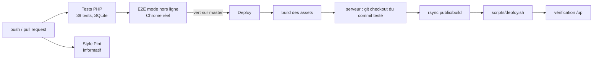

# CI/CD — Intégration et déploiement continus

| | |
|---|---|
| **Plateforme** | GitHub Actions (dépôt `Ngazid2020/mpako`) |
| **CI** | [`.github/workflows/ci.yml`](../.github/workflows/ci.yml) : à chaque push et pull request |
| **CD** | [`.github/workflows/deploy.yml`](../.github/workflows/deploy.yml) : après une CI verte sur `master`, ou manuellement |
| **Script serveur** | [`scripts/deploy.sh`](../scripts/deploy.sh) |



---

## 1. Intégration continue (`ci.yml`)

| Job | Bloquant | Contenu |
|---|---|---|
| **Tests PHP** | ✅ | PHP 8.3, `composer install`, `npm ci && npm run build` (les pages Filament lisent le manifeste Vite), `php artisan test` (SQLite en mémoire) |
| **E2E mode hors ligne** | ✅ | Base SQLite + `E2EOfflineSeeder`, `php artisan serve`, puis `npm run test:e2e` dans Chrome : préparation, coupure, bascule, vente, synchronisation. Journaux publiés en artefact si échec |
| **Style (Pint)** | ❌ informatif | `vendor/bin/pint --test`. Le code existant n'est pas encore formaté, donc ce job échoue sans bloquer (voir § 5) |

Une nouvelle exécution annule la précédente sur la même branche (`concurrency`).

### Reproduire la CI en local

```bash
php artisan test                    # tests PHP
npm run build                       # assets
# E2E sur une base jetable (ne pas utiliser la base de dev) :
touch /tmp/e2e.sqlite
DB_CONNECTION=sqlite DB_DATABASE=/tmp/e2e.sqlite php artisan migrate --force
DB_CONNECTION=sqlite DB_DATABASE=/tmp/e2e.sqlite php artisan db:seed --class=E2EOfflineSeeder
DB_CONNECTION=sqlite DB_DATABASE=/tmp/e2e.sqlite APP_URL=http://127.0.0.1:8099 php artisan serve --port=8099 &
npm run test:e2e
```

Sous Windows, si `php artisan serve` refuse le port, utilisez depuis `public/` : `php -S 127.0.0.1:8099 ../vendor/laravel/framework/src/Illuminate/Foundation/resources/server.php`.

---

## 2. Déploiement continu (`deploy.yml`)

**Déclencheurs :**
- la CI se termine **avec succès** sur `master` ;
- ou un lancement manuel (Actions → Deploy → *Run workflow*).

**Étapes :**
1. Construction des assets (`npm ci && npm run build`) à partir du **commit exact** validé par la CI.
2. Sur le serveur : `git fetch` puis `git checkout --force <sha>`.
3. Envoi de `public/build/` par `rsync`.
4. `scripts/deploy.sh` :
   - mode maintenance ;
   - `composer install --no-dev` ;
   - `migrate --force` ;
   - `optimize`, `filament:optimize` et `icons:cache` ;
   - `storage:link` ;
   - `queue:restart` ;
   - purge des tokens Sanctum expirés ;
   - remise en ligne, **même en cas d'erreur** (`trap`).
5. Vérification que `APP_URL/up` répond.

Les déploiements ne se chevauchent jamais (`concurrency: deploy-production`).

### Configuration GitHub (une seule fois)

Dans **Settings → Environments → New environment → `production`** :

| Type | Nom | Valeur |
|---|---|---|
| Secret | `SSH_HOST` | Adresse du serveur |
| Secret | `SSH_USER` | Utilisateur de déploiement (pas root) |
| Secret | `SSH_PRIVATE_KEY` | Clé privée dédiée au déploiement (`ssh-keygen -t ed25519 -C deploy-beez`) |
| Secret | `SSH_KNOWN_HOSTS` | Sortie de `ssh-keyscan -H <serveur>` |
| Secret | `DEPLOY_PATH` | Ex. `/var/www/beez` |
| Secret | `SSH_PORT` | Optionnel (22 par défaut) |
| Variable | `APP_URL` | Ex. `https://beez.km` (vérification finale) |

**Tant que ces secrets n'existent pas, le workflow s'arrête proprement sans rien déployer.**

Recommandé : dans l'environnement `production`, activer **Required reviewers** pour valider chaque mise en production d'un clic.

### Préparer le serveur (une seule fois)

| Élément | Exigence |
|---|---|
| PHP | 8.3 avec `mbstring`, `intl`, `zip`, `gd`, `bcmath`, `pdo_mysql` ; Composer |
| Base | MySQL 8 (base et utilisateur dédiés) |
| Web | Nginx ou Apache, racine sur `public/`, **HTTPS obligatoire** (service worker, mode hors ligne) |
| Planificateur | cron : `* * * * * cd /var/www/beez && php artisan schedule:run >> /dev/null 2>&1` |
| File d'attente | worker supervisé (Supervisor/systemd) : `php artisan queue:work --tries=3` |
| Code | `git clone https://github.com/Ngazid2020/mpako.git /var/www/beez`. Pour un dépôt privé, ajouter une *deploy key* en lecture seule |

Première installation sur le serveur :

```bash
cd /var/www/beez
cp .env.example .env              # puis renseigner APP_ENV=production, APP_DEBUG=false, APP_URL, DB_*, VAPID_*
composer install --no-dev --optimize-autoloader
php artisan key:generate
php artisan migrate --force
php artisan db:seed --force                              # super-admin
php artisan shield:generate --all
php artisan db:seed --class=ShopRolesSeeder --force
chown -R www-data:www-data storage bootstrap/cache
```

⚠️ Changez immédiatement le mot de passe du super-admin créé par le seeder (`admin@beez.km / password`).

---

## 3. Retour arrière (rollback)

1. Dans GitHub : *Actions → Deploy → Run workflow*, sur un commit antérieur. On peut aussi faire un `git revert` sur `master` : la CI puis le déploiement repartent automatiquement.
2. Si une migration doit être annulée : `php artisan migrate:rollback --step=1` sur le serveur, **après sauvegarde de la base**.

Les sauvegardes automatiques de la base sont prévues dans le backlog (US-605).

---

## 4. Protection de la branche `master` (recommandé)

*Settings → Branches → Add rule* sur `master` :
- *Require a pull request before merging* ;
- *Require status checks to pass* : `Tests PHP` et `E2E mode hors ligne`.

C'est l'application de la [Definition of Done](scrum/SCRUM-GUIDE.md#5-definition-of-done-dod) : aucune fusion sans CI verte.

---

## 5. Points ouverts

| Sujet | Décision proposée |
|---|---|
| **Style de code** | Lancer une fois `vendor/bin/pint` sur tout le projet, dans un commit dédié, puis rendre le job bloquant (retirer `continue-on-error`) |
| **`public/build` versionné** | La CI et le déploiement reconstruisent les assets. On peut retirer `public/build` du dépôt (`.gitignore`) : US-604 |
| **Environnement de recette** | Dupliquer `deploy.yml` avec un environnement `staging` déclenché sur une branche `develop` |
